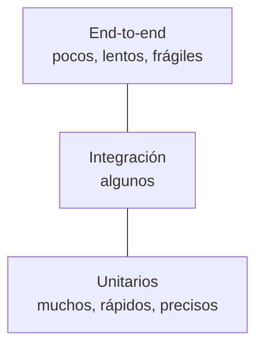

# Clase 14 — Testing de casos de uso con Vitest (sin infraestructura)

## Objetivos de la clase

- Entender **qué es un test automático**, qué problema resuelve y en qué se diferencia de probar a mano con el `.http`.
- Ubicar los distintos **niveles de test** (unitario, integración, end-to-end) y saber por qué hoy nos quedamos con los **unitarios de casos de uso y de dominio**.
- Diferenciar los **tests manuales** (el trabajo de QA) de los automáticos, y conocer el **ecosistema** de herramientas: no es solo Vitest y Jest (`node:test`, Mocha, Playwright...).
- Instalar y usar **Vitest**: `describe`, `it`, `expect`, los matchers más comunes, `it.each`, `beforeEach` y el modo *watch*.
- Escribir tests con la estructura **Arrange / Act / Assert**, con nombres que se lean como una especificación.
- Testear **errores** (síncronos y asíncronos) verificando el `code` y el `statusCode` del `AppError`.
- Conocer los **dobles de prueba** (dummy, stub, spy, mock, fake), cuándo usar cada uno, y `vi.fn()` / `vi.spyOn()`.
- Mantener los tests **aislados y deterministas**: cada test arma su propio escenario, y el tiempo lo controla un reloj fijo.
- Usar el test como **detector de acoplamiento**: si algo cuesta testearlo, el diseño está avisando algo.
- Medir la **cobertura** sin obsesionarse con el número, y comprobar que los tests **detectan bugs** rompiendo el código a propósito.
- Conocer las **costumbres de la vida real** (por qué los tests nunca tocan producción, tests intermitentes, CI) y cómo usar un **agente de IA** para escribir tests con **SDD** y un **harness**.

*(Conecta con la clase 7 y la 8: las reglas viven en casos de uso que reciben sus dependencias, y eso es lo que permite reemplazarlas en un test. Con la 10: un evento emitido se verifica con un espía. Con la 11: el hasher y el servicio de tokens se reemplazan por versiones falsas. Con la 12: el gateway externo tiene un doble sin red. Con la 13: el reloj inyectado, las funciones puras y los cuatro casos de cada regla (feliz, borde, la que la viola y "el estado no cambió") son exactamente lo que hoy automatizamos.)*

---

## 1. la situación: ¿cómo sabemos que la biblioteca funciona?

Hoy la respuesta es: **abrimos el `requests.http` y ejecutamos bloque por bloque**. En la clase 13 fueron los bloques `C1` a `C27`, más los de las clases anteriores. Para probar un préstamo vencido hubo que reiniciar el servidor con `CLOCK_NOW` en el futuro. Para probar que la API de feriados caída no impide prestar, otro reinicio con `HOLIDAYS_TYPE=fake-down`.

Funciona, pero tiene un costo que crece clase a clase:

| | Probar a mano (`.http`) | Test automático |
|---|---|---|
| ¿Cuánto tarda? | Minutos (y crece con cada regla nueva) | Milisegundos |
| ¿Quién verifica el resultado? | Una persona mirando el JSON | El código (`expect`) |
| ¿Se repite después de cada cambio? | Casi nunca: da fiaca | Siempre: es un comando |
| ¿Prepara situaciones difíciles? (vencido, API caída) | Reiniciando con variables de entorno | Pasando otro reloj u otro gateway |
| ¿Deja registro de qué se probó? | No | Sí: los tests son la lista |

El problema de fondo tiene nombre: **regresión**. Cambiás algo en `createLoan` para agregar una regla nueva y, sin darte cuenta, rompés una vieja. Si nadie vuelve a ejecutar los 60 bloques del `.http`, el bug llega a producción.

Un test automático no reemplaza al `.http` (ese prueba la app entera, con HTTP de verdad). Lo que hace es **cuidar las reglas de negocio** cada vez que tocás el código, gratis y en un segundo.

---

## 2. qué es un test automático

Un test es **código que ejecuta tu código y verifica el resultado**. Sin ningún framework, se podría escribir así:

```js
// scripts/sinFramework.js — solo para entender la idea
import assert from "node:assert";
import { addBusinessDays } from "../domain/businessDays.js";

assert.strictEqual(addBusinessDays("2026-11-04", 10, []), "2026-11-18");
assert.strictEqual(addBusinessDays("2026-11-04", 10, ["2026-11-09"]), "2026-11-19");
console.log("todo OK");
```

Si una comparación falla, `assert` lanza un error y el script termina. Es un test. Lo que un **framework** agrega es todo lo demás: correr muchos archivos, ver cuál falló y por qué, agrupar, preparar el escenario antes de cada test, espiar funciones, medir cobertura, volver a correr al guardar...

### Los niveles de test

| Nivel | Qué ejercita | Velocidad | Qué detecta | Ejemplo en la biblioteca |
|---|---|---|---|---|
| **Unitario** | Una función o un caso de uso, con sus dependencias reemplazadas | Milisegundos | Errores de lógica, reglas mal escritas, bordes | `createLoan` con DAOs en memoria y reloj fijo |
| **Integración** | Varias piezas reales juntas (router + caso de uso + Sequelize + SQLite) | Décimas de segundo | Que las piezas encajen: queries, status codes, middlewares | `POST /loans` con `supertest` sobre una base de prueba |
| **End-to-end** | La app entera desde afuera, como un usuario | Segundos | Que el sistema completo funcione | Un script que hace login, presta y devuelve |

La forma clásica de repartirlos es la **pirámide**: muchos unitarios en la base (baratos y rápidos), algunos de integración en el medio, pocos end-to-end arriba.



**Hoy trabajamos en la base**: tests unitarios de **casos de uso** y de **funciones de dominio**, *sin infraestructura*: sin servidor, sin base de datos, sin red, sin `.env`.

> **¿Qué es una "unidad"?** No es "un archivo" ni "una función". Es **un comportamiento** que tiene sentido por sí mismo: "prestar un libro", "calcular un vencimiento". El test de `createLoan` usa de verdad `addBusinessDays`, `isOverdue` y el DAO en memoria, y sigue siendo unitario: lo que reemplazamos es lo **lento o incontrolable** (la base, la red, la hora), no cada función que se llama.

### Y los tests manuales: el trabajo de QA

Que hoy automaticemos no significa que los tests manuales sean "de segunda". En la mayoría de los equipos hay personas de **QA** (*Quality Assurance*, aseguramiento de la calidad) cuyo trabajo es justamente probar el sistema, y buena parte de ese trabajo es manual **a propósito**.

Lo que venimos haciendo con el `requests.http` ya es testing manual: cada bloque (`C12. Prestar un cuarto libro → 409 LOAN_LIMIT_REACHED`) es un **caso de prueba** con pasos y un resultado esperado, y el archivo entero es un **plan de pruebas**. Un QA hace lo mismo, de forma más sistemática:

| Tipo de prueba manual | Qué es | Ejemplo en la biblioteca |
|---|---|---|
| **Casos de prueba** escritos | Pasos + datos + resultado esperado, que cualquiera puede repetir | "Con 3 préstamos activos, prestar un cuarto → 409 y el stock no cambia" |
| **Exploratoria** | Probar sin guion, buscando lo que nadie pensó | ¿Qué pasa si pido un libro con `bookId: "1"` (texto)? ¿Y con 10 pedidos seguidos con el mismo token? |
| **Regresión** | Repetir lo que ya andaba antes de cada versión | Volver a correr el plan completo antes de publicar |
| **Smoke** | Un chequeo rápido de que "lo básico respira" | Después de un deploy: login, listar libros, prestar uno |
| **Aceptación (UAT)** | El cliente o el usuario confirma que es lo que pidió | La bibliotecaria prueba el circuito de renovación y dice si le sirve |
| **Usabilidad** | ¿Se entiende? ¿Los mensajes ayudan? | ¿El mensaje de `LOAN_LIMIT_REACHED` le dice al socio qué hacer? |

Y cuando un QA encuentra un problema, no dice "no anda": escribe un **reporte de bug** con pasos para reproducirlo, resultado esperado, resultado obtenido, entorno (versión, `PERSISTENCE_TYPE`, fecha del reloj) y evidencia (la respuesta, una captura). Un buen reporte de bug es, en el fondo, un test que todavía no se automatizó (ver sección 15.5).

#### Herramientas que vas a ver en un equipo de QA

| Para qué | Herramientas |
|---|---|
| Probar APIs a mano | **Postman**, Insomnia, Bruno, Hoppscotch, y el **REST Client** de VSCode que ya usamos (`.http`) |
| Gestionar casos y planes de prueba | TestRail, Xray y Zephyr (integrados con Jira), Qase |
| Reportar y seguir bugs | Jira, GitHub Issues, Linear |
| Automatizar lo que se probaba a mano | Colecciones de Postman corridas con **Newman**; **Playwright**, **Cypress** o Selenium para interfaces web |
| Carga y rendimiento | k6, JMeter, Artillery |
| Seguridad | OWASP ZAP, Burp Suite |

Dentro de QA suele haber dos perfiles: **QA manual** (diseña casos, explora, valida con el negocio) y **QA automation** o **SDET** (programa tests automáticos, muchas veces end-to-end con Playwright o Cypress).

#### ¿Manual o automático?

No compiten: se reparten el trabajo.

| Conviene automatizar | Conviene hacerlo a mano |
|---|---|
| Lo que se repite en cada cambio (regresión) | Lo que se prueba una sola vez |
| Reglas con muchos casos y bordes (R1–R4) | Funcionalidades nuevas que todavía cambian todos los días |
| Lo que necesita "viajar en el tiempo" o simular fallas | Exploración: buscar lo que nadie anticipó |
| Lo que tiene que correr en segundos antes de mergear | Usabilidad, textos, "¿esto tiene sentido para el usuario?" |

Una regla práctica: **si te encontrás repitiendo el mismo bloque del `.http` por tercera vez, es candidato a test automático.** Y al revés: los mejores casos para automatizar muchas veces salen de lo que un QA encontró explorando a mano.

---

## 3. la cosecha: el proyecto ya estaba listo para testearse

Durante 13 clases fuimos tomando decisiones de diseño "porque está bien separar". Hoy se ve **para qué servían**: cada dependencia que se inyecta es una dependencia que en el test se puede reemplazar.

| Clase | Decisión | En el test, eso permite... |
|---|---|---|
| 7 | Las reglas viven en **casos de uso**, no en el controller | Probar las reglas sin Express, sin `req` ni `res` |
| 8 | El caso de uso recibe el **DAO por parámetro** (factory) | Pasarle un DAO en memoria nuevo en cada test |
| 9 | Dos adaptadores con la **misma interfaz** | El DAO en memoria es un sustituto legítimo del de Sequelize |
| 10 | Los efectos secundarios salen por un **bus de eventos** | Verificar "se emitió `book.lowStock`" con un espía, sin mandar ningún mail |
| 11 | `hasher` y `tokens` son **contratos inyectados** | Reemplazar bcrypt (lento) y JWT (necesita secreto) por versiones triviales |
| 12 | La API externa está detrás de un **gateway** | Un catálogo/feriados falso: sin red, sin demoras, con fallas a pedido |
| 13 | **Reloj inyectado** y **funciones puras** | Fijar "hoy" en cualquier fecha; probar el calendario con una tabla de casos |

Si `createLoan` hiciera `new Date()`, `import sequelize` y `fetch("https://api.argentinadatos.com/...")` por su cuenta, testearlo exigiría una base, internet y esperar a que algo venza. **Testeabilidad es un efecto de la arquitectura, no algo que se agrega al final.**

---

## 4. Vitest: instalación y primer test

### No hay una sola herramienta: el ecosistema de testing

Vitest y Jest son los más usados en JavaScript, pero no son los únicos. Para comparar herramientas, primero conviene saber qué **piezas** tiene cualquier herramienta de testing, porque algunas traen todo y otras solo una parte:

| Pieza | Qué hace | Ejemplos |
|---|---|---|
| **Test runner** (ejecutor) | Encuentra los archivos de test, los corre y muestra el reporte | `vitest`, `jest`, `node --test`, `mocha` |
| **Librería de aserciones** | Las funciones para comparar (`expect(...).toBe`, `assert.equal`) | `expect` de Vitest/Jest, `node:assert`, Chai |
| **Dobles de prueba** | Espías, stubs, mocks | `vi.fn()`, `jest.fn()`, `mock.fn()` de Node, Sinon |
| **Cobertura** | Medir qué líneas se ejecutaron | `@vitest/coverage-v8`, `--experimental-test-coverage` de Node, c8, Istanbul / nyc |

Vitest y Jest traen **las cuatro piezas** en un solo paquete. Otras herramientas son más "armá tu combo":

| Herramienta | Qué es | Cuándo la vas a ver |
|---|---|---|
| **Jest** | El estándar de facto durante años. Creado en Meta, hoy está en la OpenJS Foundation | Muchísimos proyectos existentes, React y React Native |
| **Vitest** | Del equipo de Vite, misma API que Jest, rápido y con soporte nativo de ESM y TypeScript. Detrás de Vite y Vitest hoy hay una empresa (VoidZero) dedicada a mantenerlos | Proyectos nuevos, proyectos con Vite |
| **`node:test`** | El test runner **incluido en Node** (estable desde Node 20): no se instala nada | Librerías y proyectos que no quieren dependencias |
| **Mocha** + **Chai** + **Sinon** | Runner + aserciones + dobles, cada uno por separado | Proyectos Node más antiguos; muy común en backends |
| **Jasmine**, **AVA**, **tap** | Otros runners con su propia filosofía | Menos frecuentes hoy |
| **Bun test**, **Deno test** | Los runners que traen esos entornos alternativos a Node | Si el proyecto corre en Bun o Deno |
| **supertest** | No es un runner: hace pedidos HTTP a una app de Express sin levantar el servidor | Tests de integración de APIs (junto con cualquiera de los de arriba) |
| **Playwright**, **Cypress**, Selenium | Manejan un navegador real | Tests end-to-end de interfaces web |

Y fuera de JavaScript las ideas son **las mismas** con otros nombres: JUnit (Java), pytest (Python), xUnit (C#), PHPUnit (PHP), `go test` (Go). Si entendés Arrange / Act / Assert, los dobles de prueba y el aislamiento, cambiar de herramienta es cuestión de leer la documentación una tarde.

#### Así se vería el primer test con la herramienta de Node

Sin instalar nada:

```js
// tests/utils/isbn.node.test.js
import { describe, it, mock } from "node:test";
import assert from "node:assert/strict";
import { hasValidIsbn13Checksum } from "../../utils/isbn.js";

describe("hasValidIsbn13Checksum (con node:test)", () => {
  it("acepta el ISBN de El principito", () => {
    assert.equal(hasValidIsbn13Checksum("9780156012195"), true);
  });

  it("también tiene espías: mock.fn()", () => {
    const emit = mock.fn();
    emit("book.lowStock", { id: 1 });
    assert.equal(emit.mock.callCount(), 1);
  });
});
```

```bash
node --test                                  # busca y corre los archivos *.test.js
node --test --experimental-test-coverage     # con cobertura
```

`describe` e `it` son iguales. Cambian las aserciones (`assert.equal` en lugar de `expect(...).toBe`) y algunos detalles: no hay `it.each`, y `toMatchObject` o `rejects.toMatchObject` se escriben con `assert.partialDeepStrictEqual` y `assert.rejects`, que son menos cómodos.

### ¿Por qué Vitest, entonces?

- La API es la **misma que la de Jest**: lo que aprendas hoy te sirve en la mayoría de los proyectos que vas a encontrar.
- El proyecto usa **módulos ES** (`"type": "module"`, `import`/`export`). Vitest los entiende sin configuración; Jest necesita un flag experimental de Node (`--experimental-vm-modules`) o transpilar con Babel.
- Trae `it.each`, `toMatchObject`, `rejects`, el modo *watch* y la cobertura con un reporte HTML listos para usar, que hacen los tests más fáciles de leer que con `node:test`.

`node:test` sería una opción perfectamente válida para un proyecto que no quiere dependencias. Lo importante no es la herramienta: es lo que viene en el resto de la clase.

### Instalación

```bash
npm install -D vitest @vitest/coverage-v8
```

El `-D` los guarda en `devDependencies`: son herramientas para **desarrollar**, no hacen falta para que la API funcione en producción.

```json
// package.json
"scripts": {
  "start": "node --env-file=.env index.js",
  "dev": "node --env-file=.env --watch index.js",
  "test": "vitest run",
  "test:watch": "vitest",
  "coverage": "vitest run --coverage"
}
```

- `npm test` corre todo una vez (lo que usaría un servidor de integración continua).
- `npm run test:watch` se queda mirando: al guardar un archivo, vuelve a correr **solo los tests afectados**. Es el modo para trabajar.
- `npx vitest run tests/domain` corre solo una carpeta; `npx vitest run -t "R1"` solo los tests cuyo nombre contiene "R1".

```js
// vitest.config.js
import { defineConfig } from "vitest/config";

export default defineConfig({
  test: {
    include: ["tests/**/*.test.js"], // dónde buscar tests
    environment: "node",
    restoreMocks: true,              // deshace los vi.spyOn después de cada test
    coverage: {
      provider: "v8",
      include: ["domain/**", "usecases/**", "utils/**"],
      reporter: ["text", "html"],
    },
  },
});
```

### Dónde van los tests

Usamos una carpeta `tests/` que **copia la estructura** del proyecto. Así, para encontrar el test de `usecases/loans/createLoan.js` se busca `tests/usecases/loans/createLoan.test.js`:

```
tests/
├── helpers/loanScenario.js        ← armado de escenarios (no es un test: no termina en .test.js)
├── domain/businessDays.test.js
├── domain/loanStatus.test.js
├── utils/isbn.test.js
└── usecases/loans/createLoan.test.js
```

*(La otra convención común es dejar `createLoan.test.js` al lado de `createLoan.js`. Las dos son válidas: lo importante es elegir una y mantenerla.)*

### El primer test

```js
// tests/utils/isbn.test.js
import { describe, it, expect } from "vitest";
import { hasValidIsbn13Checksum } from "../../utils/isbn.js";

describe("hasValidIsbn13Checksum", () => {
  it("acepta el ISBN de El principito", () => {
    expect(hasValidIsbn13Checksum("9780156012195")).toBe(true);
  });

  it("rechaza el mismo ISBN con el último dígito cambiado", () => {
    expect(hasValidIsbn13Checksum("9780156012196")).toBe(false);
  });
});
```

- `describe(nombre, fn)` **agrupa** tests relacionados (se pueden anidar).
- `it(nombre, fn)` es **un test** (`test(...)` es un alias, son lo mismo).
- `expect(valor)` envuelve el resultado real, y el **matcher** (`.toBe(...)`) lo compara con lo esperado.

```
 ✓ tests/utils/isbn.test.js (2 tests) 3ms

 Test Files  1 passed (1)
      Tests  2 passed (2)
```

Y cuando algo falla, Vitest muestra **qué esperaba y qué recibió**:

```
 FAIL  tests/utils/isbn.test.js > hasValidIsbn13Checksum > acepta el ISBN de El principito
AssertionError: expected false to be true

- Expected: true
+ Received: false
```

---

## 5. anatomía de un buen test

### Arrange / Act / Assert

Todo test tiene tres partes, y conviene que se **vean** (con una línea en blanco entre ellas):

```js
it("presta el libro, calcula el vencimiento en días hábiles y descuenta stock", async () => {
  // Arrange: preparar el escenario
  const { useCases, stockOf } = buildLoanScenario(); // hoy = miércoles 2026-11-04

  // Act: ejecutar UNA acción, la que se está probando
  const loan = await useCases.createLoan({ bookId: 1 }, ANA);

  // Assert: verificar el resultado
  expect(loan).toMatchObject({ fechaVencimiento: "2026-11-19", estado: "activo", holidaysAvailable: true });
  expect(await stockOf(1)).toBe(4);
});
```

Si el *Act* tiene muchas acciones, probablemente son **varios tests**. Si el *Arrange* es enorme, probablemente falta un **helper** (sección 10).

### El nombre es la especificación

Leé solo los nombres de un archivo de test:

```
createLoan
  R1 — como máximo 3 préstamos activos
    ✓ borde: con 2 activos, el tercero se presta
    ✓ con 3 activos, el cuarto se rechaza con 409 LOAN_LIMIT_REACHED y el mensaje dice el límite
    ✓ tras el rechazo, el estado no cambió: ni stock ni préstamos
    ✓ los préstamos devueltos no cuentan para el límite
```

Eso **es la documentación de la regla**, y a diferencia de un comentario, no puede quedar desactualizada: si la regla cambia, el test falla. Un nombre como `it("test 1")` o `it("funciona")` no dice qué se rompió cuando falla.

Regla práctica: el nombre dice **la situación y el resultado esperado**. "Con 3 activos → rechaza con LOAN_LIMIT_REACHED".

### Las propiedades de un buen test unitario

| Propiedad | Qué significa | Qué lo rompe en nuestro proyecto |
|---|---|---|
| **Rápido** | Milisegundos | Usar bcrypt real, la red, una base en disco |
| **Independiente** | No depende de otro test ni del orden | Compartir el DAO entre tests (sección 10) |
| **Repetible / determinista** | Mismo resultado hoy, mañana y en otra máquina | `new Date()`, la red, `Math.random()` |
| **Auto-verificable** | Pasa o falla solo, sin que nadie mire la consola | Un `console.log(result)` en lugar de un `expect` |
| **Oportuno** | Se escribe junto con el código, no "al final" | "Después lo testeo" |

---

## 6. los matchers que más vamos a usar

| Matcher | Para qué | Ejemplo |
|---|---|---|
| `toBe(x)` | Igualdad **estricta** (`===`): números, textos, booleanos | `expect(stock).toBe(4)` |
| `toEqual(obj)` | Igualdad **de contenido**, recursiva: objetos y arreglos | `expect(result).toEqual({ fechaVencimiento: "2026-11-19", holidaysAvailable: true })` |
| `toMatchObject(obj)` | Que **contenga** esos campos (ignora el resto) | `expect(loan).toMatchObject({ estado: "activo" })` |
| `toBeNull()`, `toBeDefined()` | `null` / no `undefined` | `expect(withStatus(null, hoy)).toBeNull()` |
| `toHaveLength(n)` | Largo de un arreglo o texto | `expect(prestamos).toHaveLength(3)` |
| `toContain(x)` | Que un arreglo contenga un elemento | `expect(codes).toContain("FORBIDDEN")` |
| `toHaveProperty(k)` | Que un objeto tenga una propiedad | `expect(user).not.toHaveProperty("passwordHash")` |
| `toThrow(...)` | Que una función **síncrona** lance | `expect(() => createClock({ fixedNow: "x" })).toThrow()` |
| `resolves` / `rejects` | Que una **promesa** se cumpla / se rechace | `await expect(p).rejects.toMatchObject({ code: "..." })` |
| `toHaveBeenCalled...` | Cómo se llamó un **espía** (sección 9) | `expect(listener).toHaveBeenCalledWith({...})` |
| `expect.stringContaining(s)` | Comodín dentro de un objeto | `{ message: expect.stringContaining("3") }` |

Cualquier matcher se niega con `.not`: `expect(spy).not.toHaveBeenCalled()`.

### La trampa de `toBe` con objetos

```js
expect({ a: 1 }).toBe({ a: 1 });    // ✗ FALLA: son dos objetos distintos en memoria
expect({ a: 1 }).toEqual({ a: 1 }); // ✓ pasa: tienen el mismo contenido
```

`toBe` compara **identidad** (¿es el mismo objeto?), `toEqual` compara **contenido**. Para objetos y arreglos casi siempre querés `toEqual` o `toMatchObject`.

### `toEqual` vs `toMatchObject`: cuánto afirmar

`toEqual` exige que el objeto sea **exactamente** ese; `toMatchObject` solo que **incluya** esos campos. El préstamo que devuelve `createLoan` trae `id`, `fechaPrestamo`, `usuario`, `libro`, `renovaciones`... Si el test de R2 usara `toEqual`, fallaría cada vez que agreguemos un campo a la respuesta, aunque el vencimiento siga bien calculado. Un test que se rompe por cambios que no le importan es un **test frágil**.

> Afirmá **lo que el test promete en su nombre**, y nada más.

---

## 7. funciones puras: tablas de casos con `it.each`

Las funciones de `domain/` son el caso más fácil del mundo: entra un dato, sale un resultado, sin dependencias. Para probar muchas combinaciones sin copiar y pegar el mismo test, `it.each` recibe una **tabla**:

```js
it.each([
  // [desde, días, feriados, esperado, descripción]
  ["2026-11-06", 1, [], "2026-11-09", "de viernes a lunes"],
  ["2026-11-07", 1, [], "2026-11-09", "empezando un sábado"],
  ["2026-11-06", 1, ["2026-11-09"], "2026-11-10", "fin de semana largo"],
  ["2026-11-04", 0, [], "2026-11-04", "cero días no mueve la fecha"],
  ["2026-12-20", 10, ["2026-12-25", "2027-01-01"], "2027-01-05", "cruzando el fin de año"],
  ["2028-02-25", 3, [], "2028-03-01", "cruzando un 29 de febrero"],
])("desde %s + %i días hábiles (feriados %j) → %s (%s)", (desde, dias, feriados, esperado) => {
  expect(addBusinessDays(desde, dias, feriados)).toBe(esperado);
});
```

Cada fila aparece en el reporte como un test aparte, con los `%s` / `%i` / `%j` reemplazados por los valores. Si falla "cruzando un 29 de febrero", lo sabés sin abrir el archivo.

### ¿Qué filas poner? Los bordes

Los bugs no viven en el medio de los datos, viven en los **bordes**. Para cada función, preguntate:

- ¿Qué pasa con **cero**, con **uno**, con **el máximo**? (0 días hábiles; 1 préstamo; el préstamo número 3)
- ¿Qué pasa **justo en el límite** y **uno antes / uno después**? (vence hoy / vencía ayer / vence mañana)
- ¿Qué pasa al **cruzar** algo? (fin de semana, fin de mes, fin de año, año bisiesto, medianoche en otra zona horaria)
- ¿Qué pasa con lo **vacío**? (lista sin feriados, CSV sin filas, `null`)

El borde más importante de la clase 13 es el de R3:

```js
it("el MISMO día del vencimiento todavía no está vencido", () => {
  expect(isOverdue({ fechaVencimiento: "2026-11-18", fechaDevolucion: null }, "2026-11-18")).toBe(false);
});
```

Si alguien escribe `<=` en lugar de `<` dentro de `isOverdue`, todos los casos "normales" siguen andando. **Solo este test lo detecta.**

---

## 8. testear errores

Nuestros casos de uso comunican los rechazos lanzando un `AppError` con `code`, `message` y `statusCode`. Testear el camino de error es tan importante como el feliz: es donde viven las reglas.

### Errores síncronos: se pasa una función

```js
expect(() => createClock({ fixedNow: "mañana" })).toThrow(/no es una fecha válida/);
```

Ojo con la flechita: si escribís `expect(createClock({ fixedNow: "mañana" }))`, el error se lanza **antes** de llegar a `expect` y el test explota en vez de verificar. `expect` necesita una función para poder llamarla él, dentro de un `try`.

### Errores asíncronos: `await expect(...).rejects`

Los casos de uso son `async`: no **lanzan**, devuelven una **promesa rechazada**. Se verifica así:

```js
it("libro inexistente → 404 BOOK_NOT_FOUND", async () => {
  const { useCases } = buildLoanScenario();

  await expect(useCases.createLoan({ bookId: 999 }, ANA)).rejects.toMatchObject({
    code: "BOOK_NOT_FOUND",
    statusCode: 404,
  });
});
```

### La trampa: olvidarse el `await`

```js
it("libro inexistente → 404", async () => {
  expect(useCases.createLoan({ bookId: 999 }, ANA)).rejects.toMatchObject({ code: "OTRA_COSA" }); // sin await
});
// ✓ PASA (¡aunque el code está mal!)
```

Sin el `await`, el test termina **antes** de que la promesa se resuelva, y un test que termina sin errores se cuenta como aprobado. Es el error más común al testear código asíncrono: el test está en verde y no verifica nada. (Vitest a veces avisa con un warning, pero no hay que depender de eso.) Una buena costumbre para detectarlo: **hacé fallar el test a propósito** la primera vez (cambiá el `code` esperado) y comprobá que se pone en rojo.

### ¿Verificar el `code` o el `message`?

El **`code` es el contrato**: el frontend decide qué hacer según `LOAN_LIMIT_REACHED`. El **mensaje es para humanos**: lo puede reescribir alguien de UX mañana, con tildes distintas, y no tendría que romper ningún test. Por eso verificamos `code` y `statusCode`, y el mensaje solo cuando **lleva un dato** que forma parte de la regla:

```js
await expect(useCases.createLoan({ bookId: 4 }, ANA)).rejects.toMatchObject({
  code: "LOAN_LIMIT_REACHED",
  statusCode: 409,
  message: expect.stringContaining("3"), // la clase 13 pidió que el mensaje diga cuál es el límite
});
```

### "Y el estado no cambió"

Un rechazo que **igual modificó algo** es un bug grave (descontó stock pero no creó el préstamo, por ejemplo). Por eso, después de verificar el error, se verifica que todo quedó como estaba:

```js
it("tras el rechazo, el estado no cambió: ni stock ni préstamos", async () => {
  const { useCases, loansDao, stockOf } = buildLoanScenario();
  for (const bookId of [1, 2, 3]) await useCases.createLoan({ bookId }, ANA);

  await useCases.createLoan({ bookId: 4 }, ANA).catch(() => {}); // sabemos que falla: miramos lo que dejó

  expect(await stockOf(4)).toBe(5);
  expect(await loansDao.getAll({ userId: ANA.id, activos: true })).toHaveLength(3);
});
```

---

## 9. dobles de prueba

Un **doble de prueba** (*test double*, como el doble de riesgo en una película) es cualquier objeto que **reemplaza a una dependencia real** durante un test. Hay varios tipos, y los nombres aparecen en cualquier equipo, así que vale la pena conocerlos:

| Tipo | Qué es | En nuestro proyecto |
|---|---|---|
| **Dummy** | Se pasa para completar la firma; nunca se usa | `vi.fn()` como `createBook` en un test donde ningún ISBN se encuentra |
| **Stub** | Devuelve respuestas **preparadas** | Un `holidays` que siempre devuelve `["2026-11-09"]`; un `tokens.sign` que devuelve `"token-de-prueba"` |
| **Spy** | Registra **cómo lo llamaron** (con qué, cuántas veces) | `events.emit = vi.fn()` para verificar que se emitió `book.lowStock` |
| **Mock** | Un espía con **expectativas** sobre cómo debe ser llamado | `expect(tokens.sign).toHaveBeenCalledWith({ sub: "7", rol: "lector" })` |
| **Fake** | Una **implementación de verdad, pero simplificada** | `BooksMemoryDao`, `LoansMemoryDao`, `createFakeHolidays()`, el reloj fijo |

*(En la práctica la gente dice "mock" para todo. No pasa nada, pero entender la diferencia ayuda a elegir.)*

### `vi.fn()`: una función espía

```js
import { vi } from "vitest";

const listener = vi.fn();                     // no hace nada, solo registra
const sign = vi.fn(() => "token-de-prueba");  // stub + spy: devuelve algo y registra
const getHolidays = vi.fn().mockResolvedValue(["2026-11-09"]);                  // promesa cumplida
const roto = vi.fn().mockRejectedValue(new AppError("EXTERNAL_TIMEOUT", "...", 504)); // promesa rechazada

// Después del Act:
expect(listener).toHaveBeenCalledOnce();
expect(listener).toHaveBeenCalledWith({ id: 1, titulo: "Libro 1", stock: 4 });
expect(getHolidays).toHaveBeenCalledTimes(2);
expect(sign).not.toHaveBeenCalled();
```

### `vi.spyOn()`: espiar un método que ya existe

```js
const spy = vi.spyOn(holidays, "getHolidays");          // sigue funcionando igual, pero registra
vi.spyOn(console, "warn").mockImplementation(() => {}); // lo reemplaza: silencia la consola en el test
```

Con `restoreMocks: true` en la configuración, todos los `spyOn` se deshacen solos al terminar cada test.

### Ejemplo: el login sin bcrypt ni JWT

`loginUser` depende de bcrypt (lento **a propósito**: cada hash tarda ~100 ms) y de jsonwebtoken (necesita `JWT_SECRET`). Ninguno de los dos es lo que queremos probar. Como los dos llegan inyectados con un contrato mínimo, los reemplazamos por versiones triviales:

```js
const hasher = {
  hash: vi.fn(async (plain) => `hash:${plain}`),
  compare: vi.fn(async (plain, hash) => hash === `hash:${plain}`),
};
const tokens = { sign: vi.fn(() => "token-de-prueba") };
```

Y así se puede probar la regla de seguridad de la clase 11, que con el `.http` era imposible de verificar:

```js
it("aunque el email no exista, igual compara contra el hash falso (para no delatarse por el tiempo)", async () => {
  await loginUser({ email: "nadie@test.com", password: "otra" }, dao, hasher, tokens, dummyHash).catch(() => {});

  expect(hasher.compare).toHaveBeenCalledWith("otra", "hash:dummy");
});
```

### ¿Fake o spy? Preferí verificar el resultado

Hay dos formas de verificar algo:

- **Por estado / resultado:** "después de prestar, el stock es 4".
- **Por interacción:** "se llamó a `booksDao.adjustStock(1, -1)`".

La segunda **ata el test a la implementación**: si mañana el DAO descuenta el stock de otra forma, el test se rompe aunque el comportamiento sea idéntico. Por eso, para los DAOs usamos **fakes** (el DAO en memoria) y verificamos el estado.

Los espías los reservamos para cuando **la interacción ES el comportamiento**:

- "Se emitió `book.lowStock`" (el efecto es justamente avisar).
- "**No** se consultó la API de feriados si una regla rechazó el pedido" (fail fast: es una regla de la clase 13).
- "Se firmó el token con `sub` y `rol`, y nada más" (qué va en el payload es una decisión de seguridad).

### ¿Y `vi.mock()`?

Vitest puede reemplazar **un módulo entero** (`vi.mock("../../config/config.js", ...)`) para que un `import` devuelva otra cosa. Es una herramienta potente para código que **no** recibe sus dependencias por parámetro. Nosotros casi nunca la necesitamos: como inyectamos todo, alcanza con pasar otra cosa. Si te encontrás usando `vi.mock` para testear un caso de uso, preguntate primero si no conviene inyectar esa dependencia (sección 12).

---

## 10. aislamiento: cada test arma su propio mundo

### El problema del estado compartido

Mirá el final de `BooksMemoryDao.js`:

```js
export { BooksMemoryDao };
export default new BooksMemoryDao(); // UNA instancia para todo el proceso
```

Si dos tests usan esa instancia, comparten el estado:

```js
it("presta el libro 2", async () => { /* stock del libro 2: 1 → 0 */ });
it("presta el libro 2 a otra persona", async () => { /* ✗ OUT_OF_STOCK: el test anterior se lo llevó */ });
```

El segundo test pasa o falla **según qué test corrió antes**. Y peor: si lo corrés solo (`-t "otra persona"`), pasa. Son los bugs más frustrantes de una suite de tests. La regla es simple: **ningún test depende de otro**. Cada uno prepara todo lo que necesita.

Por eso, en los tests **instanciamos la clase** (`new BooksMemoryDao(...)`) en lugar de importar el `default`. Ese `export { BooksMemoryDao }` estaba en el código desde la clase 8 con el comentario *"por si se requiere instanciar nuevamente (ej: en tests)"*. Hoy es ese día.

Hay una segunda trampa más sutil: `BooksMemoryDao` guarda **los mismos objetos** que le pasás y les modifica el `stock`. Si los libros de prueba son una constante compartida, el primer préstamo modifica la constante. Por eso el helper los **copia** antes de pasarlos: `books.map((b) => ({ ...b }))`.

### `beforeEach`: preparar antes de cada test

Para archivos simples, `beforeEach` corre antes de **cada** `it` y deja todo limpio:

```js
let dao;
let events;

beforeEach(() => {
  dao = new BooksMemoryDao([{ id: 1, titulo: "El principito", autor: "Saint-Exupéry", isbn: "9780156012195", stock: 3 }]);
  events = { emit: vi.fn() };
});
```

(También existen `afterEach`, `beforeAll` y `afterAll`. `beforeAll` corre **una vez** por archivo: sirve para cosas caras y de solo lectura, y es justo lo que **no** queremos para datos que los tests modifican.)

### Un helper de escenarios

`createLoan` necesita **ocho** dependencias. Armarlas en cada test sería ruido que tapa lo importante. Un **helper** (o *builder*) arma el mundo completo con valores por defecto razonables, y cada test cambia **solo lo que le importa**:

```js
// tests/helpers/loanScenario.js (resumen)
export function buildLoanScenario({
  now = "2026-11-04T12:00:00-03:00",
  loanRules = {},
  holidays = createFakeHolidays(),
  lowStockThreshold = 0,
} = {}) {
  const booksDao = new BooksMemoryDao(BOOKS.map((b) => ({ ...b })));
  const usersDao = new UsersMemoryDao(USERS.map((u) => ({ ...u })));
  const loansDao = new LoansMemoryDao(booksDao, usersDao);
  const events = createEventBus();
  const clock = createClock({ fixedNow: now });
  const rules = { maxActive: 3, businessDays: 10, maxRenewals: 1, ...loanRules };

  const useCases = makeLoanUseCases({ loansDao, booksDao, usersDao, events, clock, holidays, loanRules: rules, lowStockThreshold });
  return { useCases, loansDao, booksDao, events, clock, holidays, givenLoan, stockOf };
}
```

Fijate que el test usa **la misma factory que el Composition Root** (`makeLoanUseCases`). El helper es, en el fondo, un `container.js` para tests: mismas piezas, distintas implementaciones.

Y así se lee un test que necesita algo distinto:

```js
const { useCases } = buildLoanScenario({ loanRules: { maxActive: 1 } });           // otra regla
const { useCases } = buildLoanScenario({ holidays: createFakeHolidays({ fail: true }) }); // API caída
const { useCases } = buildLoanScenario({ now: "2026-11-05T09:00:00-03:00" });        // otro "hoy"
```

### Preparar el pasado: `givenLoan`

¿Cómo se prueba que un usuario con un préstamo **vencido** no puede pedir otro? Con la API habría que prestar y esperar dos semanas. En el test, escribimos el pasado **directamente en el DAO**, sin pasar por las reglas:

```js
const { useCases, givenLoan } = buildLoanScenario(); // hoy: 2026-11-04
await givenLoan({ userId: ANA.id, bookId: 1, fechaVencimiento: "2026-11-03" }); // venció ayer

await expect(useCases.createLoan({ bookId: 2 }, ANA)).rejects.toMatchObject({ code: "USER_HAS_OVERDUE_LOANS" });
```

`givenLoan` usa `loansDao.lend(...)` con las fechas que le pasamos. Eso es posible porque en la clase 13 las fechas pasaron a decidirse **en el caso de uso** (con el reloj) y el DAO solo las guarda.

---

## 11. el tiempo en los tests

Todo lo que depende de "hoy" es **no determinista** por naturaleza: un test que pasa el lunes puede fallar el sábado. Con el reloj inyectado de la clase 13, el problema desaparece: en el test, "hoy" es lo que digamos.

```js
// Mismo préstamo, dos "hoy" distintos: así se prueba el borde de R3 sin esperar nada
it("borde: si vence HOY todavía no está vencido, y puede pedir otro", async () => {
  const { useCases, givenLoan } = buildLoanScenario({ now: "2026-11-04T12:00:00-03:00" });
  await givenLoan({ userId: ANA.id, bookId: 1, fechaVencimiento: "2026-11-04" });

  await expect(useCases.createLoan({ bookId: 2 }, ANA)).resolves.toBeDefined();
});

it("el mismo préstamo pasa a estar vencido si 'viajamos' un día al futuro", async () => {
  const { useCases, givenLoan } = buildLoanScenario({ now: "2026-11-05T09:00:00-03:00" });
  await givenLoan({ userId: ANA.id, bookId: 1, fechaVencimiento: "2026-11-04" });

  await expect(useCases.createLoan({ bookId: 2 }, ANA)).rejects.toMatchObject({ code: "USER_HAS_OVERDUE_LOANS" });
});
```

Y el caso de zona horaria que justificó trabajar con días `AAAA-MM-DD`:

```js
it("today() usa la zona horaria de la biblioteca, no UTC", () => {
  const clock = createClock({ fixedNow: "2026-11-05T02:30:00Z" }); // 23:30 del 4 en Buenos Aires

  expect(clock.today()).toBe("2026-11-04");
});
```

### ¿Y `vi.useFakeTimers()`?

Vitest puede "congelar" el reloj global (`vi.setSystemTime(...)`) para que `new Date()` devuelva lo que quieras **aunque el código no reciba un reloj**. Es la solución cuando no podés cambiar el código. Pero tiene costos: afecta a **todo** el proceso (incluidos `setTimeout` y librerías), hay que acordarse de restaurarlo, y esconde la dependencia en lugar de hacerla visible. Con el reloj inyectado, la dependencia del tiempo **está en la firma** del caso de uso, y cualquiera que lo lea sabe que el resultado depende de la fecha.

*(`useFakeTimers` sí es muy útil para otra cosa: probar código con `setTimeout`, como los reintentos con espera creciente de la clase 12, sin esperar los segundos reales.)*

---

## 12. el test como detector de acoplamiento

Intentemos testear `createBook`, el caso de uso más simple del proyecto, tal como quedó en la clase 13:

```js
// tests/usecases/books/createBook.test.js
import createBook from "../../../usecases/books/createBook.js";
```

```
 FAIL  tests/usecases/books/createBook.test.js
Error: Falta la variable de entorno JWT_SECRET (copiá .env.example a .env y completala)
 ❯ config/config.js:15:9
```

**El archivo explota antes de correr un solo test.** ¿Qué tiene que ver crear un libro con el secreto de los tokens? Nada. Pero `createBook` hace esto:

```js
import { LOW_STOCK_THRESHOLD } from "../../config/config.js"; // ← importa TODA la configuración
```

y `config.js` (con buen criterio, desde la clase 11) se niega a arrancar sin `JWT_SECRET`. El caso de uso quedó **acoplado a la configuración de toda la aplicación**.

Hay dos "soluciones":

1. **La que tapa el síntoma:** definir `JWT_SECRET` en el entorno de los tests, o usar `vi.mock("../../config/config.js")`. Funciona, pero el acoplamiento sigue ahí.
2. **La que arregla el diseño:** hacer con el umbral lo mismo que hicimos en la clase 13 con `loanRules`: **inyectarlo**.

```js
// usecases/books/createBook.js
async function createBook(data, dao, events, lowStockThreshold) {
  // ...
  if (created.stock <= lowStockThreshold) {
    events.emit(EVENTS.BOOK_LOW_STOCK, { id: created.id, titulo: created.titulo, stock: created.stock });
  }
}

// usecases/books/makeBookUseCases.js
function makeBookUseCases(dao, loansDao, events, catalog, { importConcurrency, lowStockThreshold }) {
  const createBookUseCase = (data) => createBook(data, dao, events, lowStockThreshold);
  // ...
}

// container/container.js
makeBookUseCases(booksDao, loansDao, events, catalog, { importConcurrency: IMPORT_CONCURRENCY, lowStockThreshold: LOW_STOCK_THRESHOLD });
```

Ahora el test no necesita ninguna variable de entorno, y además puede probar **cualquier umbral**:

```js
it("el umbral llega inyectado: con umbral 10, un stock de 5 ya es bajo", async () => {
  await createBook({ titulo: "Rayuela", autor: "Cortázar", stock: 5 }, dao, events, 10);

  expect(events.emit).toHaveBeenCalledOnce();
});
```

> **Si cuesta testearlo, está acoplado.** La dificultad para escribir un test casi nunca es un problema "del test": es el diseño avisando que una pieza depende de más cosas de las que debería. Por eso conviene escribir los tests **mientras** se escribe el código, y no meses después: el aviso llega cuando todavía es barato hacerle caso.

*(La reflexión de la clase 10 sigue valiendo: el umbral es una regla del caso de uso. Lo que cambió es **de dónde la recibe**.)*

---

## 13. escribiendo los escenarios de una regla

La sección 8 de la clase 13 decía que una regla se prueba con cuatro casos. Pasados a tests de `createLoan`, R1 queda así:

| Caso (clase 13) | Test |
|---|---|
| 1. Feliz | "borde: con 2 activos, el tercero se presta" (el feliz y el borde coinciden) |
| 2. Borde | idem: el préstamo número 3 **sí** |
| 3. La viola | "con 3 activos, el cuarto se rechaza con 409 LOAN_LIMIT_REACHED y el mensaje dice el límite" |
| 4. El estado no cambió | "tras el rechazo, el estado no cambió: ni stock ni préstamos" |

Y aparecen casos que el `.http` no cubría, porque eran incómodos de preparar:

- "Los préstamos **devueltos** no cuentan para el límite".
- "El límite es **de cada usuario**: que Ana llegue al tope no afecta a Beto".
- "El tope es **configuración**: con `maxActive = 1`, el segundo ya se rechaza".

### Testear el orden de las reglas

La clase 13 insistió en que **el orden de los chequeos importa** (R3 antes que R1, porque "devolvé el vencido" es más útil que "llegaste al tope"). Eso también es comportamiento, y también se testea, armando un escenario que viola **las dos** reglas a la vez:

```js
it("orden: si está en el tope Y tiene uno vencido, gana R3 (el mensaje útil es 'devolvelo')", async () => {
  const { useCases, givenLoan } = buildLoanScenario();
  await givenLoan({ userId: ANA.id, bookId: 1, fechaVencimiento: "2026-10-30" }); // vencido
  await givenLoan({ userId: ANA.id, bookId: 2, fechaVencimiento: "2026-11-20" });
  await givenLoan({ userId: ANA.id, bookId: 3, fechaVencimiento: "2026-11-20" }); // ya tiene 3

  await expect(useCases.createLoan({ bookId: 4 }, ANA)).rejects.toMatchObject({ code: "USER_HAS_OVERDUE_LOANS" });
});
```

### Testear la degradación elegante

Con los dobles, las fallas de terceros se prueban sin desenchufar nada:

```js
it("si la API de feriados está caída, presta igual contando solo fines de semana", async () => {
  const { useCases } = buildLoanScenario({ holidays: createFakeHolidays({ fail: true }) });
  vi.spyOn(console, "warn").mockImplementation(() => {}); // silenciamos el aviso

  const loan = await useCases.createLoan({ bookId: 1 }, ANA);

  expect(loan).toMatchObject({ fechaVencimiento: "2026-11-18", holidaysAvailable: false });
});

it("un error que NO es de la API (un bug propio) no se oculta", async () => {
  const holidaysRoto = { getHolidays: vi.fn().mockRejectedValue(new TypeError("x is not a function")) };
  const { useCases } = buildLoanScenario({ holidays: holidaysRoto });

  await expect(useCases.createLoan({ bookId: 1 }, ANA)).rejects.toThrow(TypeError);
});
```

El segundo test protege una decisión de la clase 12 que es fácil de "simplificar" sin querer: el `if (!(err instanceof AppError)) throw err`. Si alguien lo borra, la API seguiría respondiendo `201` con bugs escondidos, y **este test es el único que se entera**.

---

## 14. ¿cuánto testear? cobertura y tests que protegen

### Cobertura

```bash
npm run coverage
```

```
File               | % Stmts | % Branch | % Funcs | % Lines | Uncovered Line #s
-------------------|---------|----------|---------|---------|-------------------
All files          |   50.98 |    56.48 |   37.03 |   51.73 |
 usecases/loans    |   82.29 |    74.24 |   72.22 |   82.22 |
  getLoans.js      |       0 |        0 |       0 |       0 | 13-29
  returnLoan.js    |    92.3 |    91.66 |     100 |    92.3 | 28
```

*(El reporte de texto **oculta los archivos con 100%**, como `domain/` o `createLoan.js`: muestra solo lo que tiene algo pendiente. En `coverage/index.html` se ven todos.)*

- **Stmts / Lines:** qué porcentaje de las líneas se ejecutó al menos una vez durante los tests.
- **Branch:** qué porcentaje de los caminos de cada `if` / `?:` / `??` se recorrió (el `if` **y** el `else`).
- **Uncovered Line #s:** las líneas que **ningún** test ejecutó. Es lo más útil del reporte.
- `coverage/index.html` muestra cada archivo con las líneas no cubiertas pintadas de rojo.

La cobertura dice **qué NO está testeado**, y eso es valioso: `returnLoan.js` línea 28 es el caso de carrera "otro pedido lo devolvió justo antes". Nadie lo probó.

Pero **no dice que lo testeado esté bien**. Un test que llama a `createLoan` y no tiene ningún `expect` sube la cobertura al 100% y no verifica nada. Por eso:

> **100% de cobertura no es la meta.** La meta es que las reglas que importan estén protegidas. Un 80% bien elegido vale más que un 100% de tests que no afirman nada.

### ¿Qué priorizar?

| Sí, primero | Después, o no |
|---|---|
| Reglas de negocio (R1–R5, permisos, existencia) | Getters triviales (`getBookById` que solo llama al DAO) |
| Bordes (el préstamo 3 y el 4, vence hoy, cruce de año) | Código de librerías externas (Zod, Express, Sequelize ya tienen sus tests) |
| Caminos de error y "el estado no cambió" | Controllers y routers (eso es integración) |
| Lógica de calendario, cálculo, transformación (funciones puras) | `console.log`, configuración |
| Bugs que ya pasaron (un test por cada bug arreglado, para que no vuelva) | |

### ¿Mis tests protegen algo? Rompé el código a propósito

La prueba de fuego de un test es: **si introduzco un bug, ¿falla?** Hagamos la prueba en `createLoan`:

```js
if (activeLoans.length >= loanRules.maxActive) {   // original
if (activeLoans.length > loanRules.maxActive) {    // bug: ahora se pueden tener 4
```

```
 × con 3 activos, el cuarto se rechaza con 409 LOAN_LIMIT_REACHED y el mensaje dice el límite
 × tras el rechazo, el estado no cambió: ni stock ni préstamos
 × el tope es configuración: con maxActive = 1, el segundo ya se rechaza
 × fail fast: si una regla rechaza el pedido, NO se consulta la API de feriados

 Tests  4 failed | 114 passed (118)
```

Cuatro tests lo detectan. Si **ninguno** hubiera fallado, nos faltaría un test. Esta técnica (alterar el código para ver si los tests lo notan) tiene un nombre, **mutation testing**, y existen herramientas que la automatizan. A mano, con dos o tres cambios en las reglas más importantes, ya da muchísima información.

---

## 15. tips de la vida real

Lo que sigue no es teoría de testing: son costumbres de equipos que testean todos los días. Algunas parecen obvias hasta que te pasan.

### 15.1. Los tests nunca apuntan a la base de producción

Es verdad, y vale aunque el test "solo cree cosas temporales y las borre al final". Esos datos temporales:

- **Disparan efectos reales**: un préstamo de prueba emite `book.lowStock`, y en producción el notificador no escribe en la consola, **manda un mail**.
- **Ensucian lo que no se borra**: los ids autoincrementales se consumen, quedan registros en logs y auditoría, y aparecen en los reportes y en el CSV de la clase 12.
- **Chocan con usuarios reales**: el test descuenta stock del libro que alguien está por pedir, o le gana el último ejemplar.
- **No siempre se limpian**: si el test falla o se corta a la mitad, el `afterEach` que borraba nunca corre.
- **Pegan a APIs de terceros** con la cuenta y el límite de pedidos de producción.

Por eso la suite (`npm test`) corre **en tu máquina y en el servidor de integración continua**, nunca contra producción, y cada nivel tiene su propia base:

| Tipo de test | ¿Qué base usa? |
|---|---|
| Unitarios (los de hoy) | **Ninguna**: DAOs en memoria |
| Integración | Una base **propia y descartable**: SQLite en `:memory:`, o una base de test que se crea y se destruye en cada corrida |
| End-to-end | Un entorno de **staging** (copia de producción con datos falsos) |

> **El matiz: "testing in production" existe, pero es otra cosa.** Después de un deploy, muchos equipos corren un *smoke test* (¿responde `/health`? ¿anda el login?), tienen *monitoreo sintético* (un robot que cada 5 minutos consulta un libro) o hacen *canary releases* (la versión nueva le llega primero al 5% de los usuarios). Son chequeos chicos, casi siempre **de solo lectura**, y cuando escriben algo usan cuentas de prueba marcadas y fáciles de excluir. No es correr la suite.

**Ojo con nuestro propio proyecto:** `connection/sequelize.js` usa `storage: "./database.sqlite"`. Un test de integración que importe esa conexión tal cual **escribe en tu base de desarrollo**. La forma segura es que la conexión también se configure por variable de entorno (`DB_STORAGE=:memory:` en los tests), y además poner una **barrera** que se niegue a correr si algo huele a producción:

```js
// tests/setup.js (se registra en vitest.config.js con setupFiles: ["tests/setup.js"])
if (process.env.NODE_ENV === "production" || process.env.DATABASE_URL?.includes("prod")) {
  throw new Error("Los tests no se corren contra producción. Revisá tus variables de entorno.");
}
```

### 15.2. Los tests no usan secretos ni servicios reales

- Nada de `JWT_SECRET` de producción, claves de APIs pagas ni contraseñas reales en un test: los tests se suben al repositorio y los lee cualquiera.
- Si un test necesita un secreto, que sea uno inventado (`"secreto-de-test"`). Mejor todavía: que no lo necesite (sección 12).
- Los mails, SMS y pagos se reemplazan **siempre** por dobles. Un test que manda un mail real termina, tarde o temprano, mandándoselo a un cliente.

### 15.3. Un test que falla "a veces" es un bug, no mala suerte

Un **test intermitente** (*flaky*) pasa y falla sin que nadie toque el código. Casi siempre la causa es una de estas: la hora real, el orden de los tests, el estado compartido, la red, o un `setTimeout` con un tiempo justo. El peor remedio es "volver a correrlo hasta que pase": a las dos semanas nadie confía en la suite y se ignoran también los fallos de verdad. Se arregla, o se borra y se escribe bien.

### 15.4. Nunca subas un `.only`

`it.only(...)` y `describe.only(...)` corren **solo ese** test: son muy cómodos mientras trabajás en uno. Pero si se suben al repositorio, el resto de la suite deja de correr y todo "pasa". Vitest falla a propósito si encuentra un `.only` cuando corre en CI; igual, revisalo antes de cada commit. `it.skip` (saltear) y `it.todo` (pendiente) sí se pueden subir, pero con un motivo y por poco tiempo.

### 15.5. Cada bug arreglado deja un test

Cuando aparece un bug: **primero** escribí el test que lo reproduce y comprobá que falla, **después** arreglalo y comprobá que pasa. Así queda demostrado que el arreglo funciona, y el bug no puede volver sin que alguien se entere. Es la forma más barata de construir una suite útil: cada test existe porque algo ya se rompió una vez.

### 15.6. La suite corre antes de mergear, no "cuando me acuerdo"

El valor de los tests está en que corren **siempre**. Lo habitual es que el servidor de integración continua (GitHub Actions, GitLab CI) ejecute `npm test` en cada *pull request*, y que no se pueda mergear con tests en rojo. Localmente, `npm run test:watch` mientras programás.

### 15.7. Rápidos o no se usan

Si la suite tarda 10 minutos, nadie la corre antes de hacer *push*. Mantené los unitarios en milisegundos: nada de bcrypt real, red ni base. Y nada de esperas fijas (`await wait(2000)` "para que termine"): si algo depende del tiempo, se inyecta el reloj o se usan *fake timers*.

### 15.8. Los tests también son código

Se leen, se revisan en el *code review* y se refactorizan. Un test que nadie entiende es un test que alguien va a borrar cuando falle. Valen las mismas reglas que para el resto del código: buenos nombres, nada de duplicación innecesaria (para eso están los helpers), y nada de lógica complicada **dentro** del test (`if`, `for` con cálculos): si el test calcula el resultado esperado con la misma lógica que el código, va a tener el mismo bug.

### 15.9. No mockees lo que no es tuyo

No hagas `vi.mock("bcryptjs")` ni `vi.mock("sequelize")`: estarías adivinando cómo se comporta una librería que no controlás, y el test seguiría pasando aunque la librería cambie. Lo que hicimos durante el curso es la alternativa: **envolver** la librería en una pieza propia con un contrato chico (`hasher`, `tokens`, `catalog`, `holidays`) y reemplazar **esa** pieza. Lo que hay adentro del envoltorio se prueba, si hace falta, con un test de integración.

### 15.10. Un test en verde que nunca viste en rojo no prueba nada

Antes de confiar en un test nuevo, rompé a propósito el código que dice proteger (o cambiá el valor esperado) y mirá que falle. Es la versión de un minuto de la sección 14, y atrapa los `await` olvidados, los `expect` que nunca se ejecutan y los tests que miran el objeto equivocado.

---

## 16. tests con un agente de IA: SDD y harness

Un agente de programación (Claude Code, Copilot, Cursor...) puede escribir los 118 tests de hoy en minutos. Si le decís solo "haceme los tests de createLoan", el resultado típico es este: muchos tests que **pasan**, con nombres genéricos, que verifican cómo está escrito el código y no qué debería hacer (si el código tiene un bug, el agente escribe el test que lo confirma), con un `vi.mock` para cada cosa, y a veces con el código de producción "arreglado" para que el test pase.

Dos ideas ayudan a usarlo bien:

**SDD (*Spec-Driven Development*, desarrollo guiado por especificación).** Primero se escribe y se aprueba una **especificación**: qué comportamientos hay que verificar, con sus casos de borde y sus errores, en lenguaje natural. Recién después el agente escribe el código (acá, los tests) a partir de ella. Con esto:

- Lo que revisás es la **spec**, que es corta y se lee en dos minutos. Es mucho más fácil detectar ahí que falta el borde de "vence hoy" que en 400 líneas de tests.
- Los tests salen de **lo que la regla debería hacer** (la tabla R1–R5 de la clase 13), no de lo que el código hace hoy.
- La spec queda en el repositorio como documentación.

**Harness (el "arnés" del agente).** Es todo lo que rodea al modelo y lo mantiene en carril: las **instrucciones del proyecto** (un archivo `AGENTS.md` o `CLAUDE.md` en la raíz, que el agente lee siempre), los **comandos** que puede usar para verificar su trabajo (`npm test`, `npm run coverage`), los **límites** (qué archivos puede tocar y cuáles no) y una **definición de terminado** que se pueda comprobar ejecutando algo y no "porque el agente dice que terminó". Un buen arnés convierte las convenciones de esta clase (el helper de escenarios, nada de `.env`, verificar `code` y no `message`, romper el código a propósito) en reglas que el agente sigue sin que se las repitas en cada pedido.

En `prompt-agente.md` hay un `AGENTS.md` listo para copiar y los prompts para cada fase (spec → revisión → tests → verificación).

> **Vos seguís siendo el responsable.** El agente acelera la escritura, no la reemplaza: la spec la aprobás vos, y si un test está mal, el bug que se escapa es tuyo.

---

## 17. errores comunes

| Error | Consecuencia | Qué hacemos |
|---|---|---|
| Olvidar el `await` en `expect(...).rejects` | El test pasa siempre, sin verificar nada | `await expect(...)`, y hacerlo fallar a propósito una vez |
| `expect(fn())` en lugar de `expect(() => fn())` para errores síncronos | El error salta antes de que `expect` lo atrape | Pasar una función |
| `toBe` con objetos | Falla aunque el contenido sea igual | `toEqual` / `toMatchObject` |
| Compartir el DAO (o los datos de prueba) entre tests | Tests que dependen del orden; pasan solos y fallan juntos | Instancia nueva por test; copiar los datos |
| Usar `new Date()` o la red en un test | Pasa hoy, falla el sábado o sin wifi | Reloj fijo, gateways falsos |
| Afirmar de más (`toEqual` del préstamo entero) | Test frágil: falla por cambios que no le importan | Afirmar lo que dice el nombre |
| Verificar el texto exacto del mensaje | Se rompe al corregir una tilde | Verificar `code` y `statusCode` |
| Verificar con espías cómo se implementó (`adjustStock` llamado con...) | Falla al refactorizar aunque el comportamiento no cambie | Verificar el resultado y el estado; espías solo cuando la interacción es el comportamiento |
| Varios comportamientos en un solo `it` | Cuando falla, no sabés cuál | Un comportamiento por test |
| Nombres como `"test 1"` o `"funciona"` | El reporte no dice qué se rompió | Situación → resultado esperado |
| Arreglar un test "incómodo" con `vi.mock` o variables de entorno | El acoplamiento sigue ahí | Escuchar al test: inyectar la dependencia |
| Testear solo el caso feliz | Las reglas viven en los errores y los bordes | Los cuatro casos de cada regla |
| Correr tests contra la base de producción ("total borro lo que creo") | Mails reales, datos sucios, choques con usuarios reales | Base propia y descartable; barrera en el setup de los tests |
| Pedirle a un agente "haceme los tests" sin spec ni reglas | Tests que confirman los bugs, `vi.mock` por todos lados, código de producción tocado | SDD + `AGENTS.md` (`prompt-agente.md`) |
| Perseguir el 100% de cobertura | Tests sin `expect` que solo suben el número | Cobertura como mapa de lo que falta, no como meta |

---

## 18. lo que NO vimos (y que existe)

- **Tests de integración HTTP** con `supertest`: levantar la app de Express en memoria y hacer `POST /loans` de verdad, verificando status codes, headers (`Location`) y el error handler.
- **Tests de contrato del DAO**: correr **el mismo** archivo de tests contra `LoansMemoryDao` y `LoansSequelizeDao` (con SQLite en `:memory:`), para garantizar que los dos adaptadores se comportan igual. Es la forma de verificar en serio la promesa de la clase 9.
- **TDD** (*Test-Driven Development*): escribir el test **antes** que el código. Rojo (el test falla) → verde (el código mínimo que lo hace pasar) → refactor.
- **Integración continua** (GitHub Actions, GitLab CI): que `npm test` corra solo en cada *push* y bloquee el *merge* si algo falla.
- **Mutation testing automático** (Stryker): genera cientos de "bugs" en tu código y te dice cuáles no detectó ningún test.
- **Property-based testing** (`fast-check`): en vez de escribir los casos a mano, se describe una propiedad ("sumar N días hábiles nunca cae en sábado") y la herramienta prueba miles de entradas al azar.
- **Snapshot testing** (`toMatchSnapshot`): guarda la salida la primera vez y avisa si cambia. Útil para salidas grandes (un CSV entero), peligroso si se aceptan los cambios sin mirar.
- **Tests end-to-end** y bases de datos reales en contenedores (Testcontainers) para probar contra PostgreSQL de verdad.

---

## Cierre

- Un test automático es **código que verifica código**: cuida las reglas contra las **regresiones** cada vez que cambiamos algo, en milisegundos. No reemplaza al testing **manual** de QA (exploración, aceptación, usabilidad): se reparten el trabajo.
- Vitest es **una** herramienta entre varias (Jest, `node:test`, Mocha...): las ideas de hoy sirven para cualquiera.
- Hoy escribimos tests **unitarios** de **casos de uso** y **dominio**, sin servidor, sin base, sin red y sin `.env`. Fue posible porque durante 13 clases **inyectamos** cada dependencia: testeabilidad es un efecto de la arquitectura.
- Un buen test tiene **Arrange / Act / Assert**, un nombre que se lee como una especificación, y afirma **lo que promete, y nada más**.
- Los errores se verifican por su **`code`** y **`statusCode`**, con `await expect(...).rejects`, y después se verifica que **el estado no cambió**.
- Los **dobles de prueba** reemplazan lo lento o incontrolable: **fakes** para los DAOs, **stubs** para el hasher y los gateways, **espías** cuando la interacción es el comportamiento (un evento emitido, una API que no se debió consultar).
- Cada test arma **su propio mundo** (instancias nuevas, datos copiados, reloj fijo): nada se comparte, nada depende del orden ni del día.
- **Si cuesta testearlo, está acoplado**: el test de `createBook` destapó una dependencia de `config.js` que se resolvió inyectando el umbral.
- La **cobertura** muestra lo que falta; **romper el código a propósito** muestra si los tests protegen algo.

La próxima clase (15) también es de **calidad**: documentamos la API con **Swagger/OpenAPI**, escribimos un **README** profesional y repasamos un checklist de buenas prácticas. Los nombres de los tests de hoy son un buen punto de partida para describir qué hace cada endpoint.
