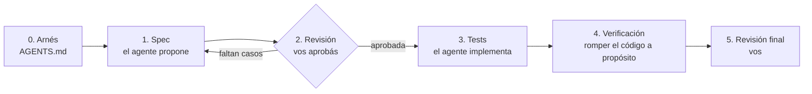

# Clase 14 — Escribir los tests con un agente de IA (SDD + harness)

Esta guía es para hacer la consigna (o parte de ella) con un agente de programación: Claude Code, Copilot en modo agente, Cursor, Codex, etc. **No reemplaza entender la clase**: la idea es que el agente escriba rápido y vos decidas qué se prueba y revises si quedó bien.

Antes de empezar, leé la sección 16 del material teórico. En resumen:

- **SDD (Spec-Driven Development):** primero una **especificación** de qué hay que verificar, aprobada por vos. Recién después, el código.
- **Harness (arnés):** las instrucciones, los comandos, los límites y la definición de terminado que rodean al agente para que no se salga del carril.



La regla de oro: **una fase por pedido**. Si le pedís todo junto ("especificá, testeá y verificá"), el agente se saltea la parte en la que vos intervenís.

---

## Paso 0: el arnés (`AGENTS.md`)

Creá este archivo en la raíz del proyecto (`clases/14_clase/AGENTS.md`). La mayoría de los agentes lo leen solos al empezar. Si el tuyo usa otro nombre (Claude Code lee `CLAUDE.md`), copialo con ese nombre o creá un `CLAUDE.md` que diga `Leé AGENTS.md`.

````markdown
# AGENTS.md — Biblioteca API (Clase 14: testing)

## Proyecto
API REST en Node.js + Express, módulos ES ("type": "module"), arquitectura en capas:
routes → controllers → usecases → dao. Las dependencias se INYECTAN (factories `make*UseCases` y
`container/container.js`). Los casos de uso no leen process.env, no llaman a new Date() ni a fetch.

## Comandos
- Correr los tests: `npm test`
- Un solo archivo: `npx vitest run tests/usecases/loans/createLoan.test.js`
- Cobertura: `npm run coverage`
- NO ejecutes `npm start` ni `npm run dev`, y no instales dependencias nuevas sin preguntar.

## Qué podés tocar
- SÍ: `tests/**` y `specs/**`.
- NO: ningún archivo fuera de esas carpetas (código de producción, `package.json`, `vitest.config.js`, `.env*`).
- Si para testear algo te parece que hay que cambiar código de producción, NO lo cambies: frená y explicá por qué.
- Si un test falla y creés que el bug está en el código de producción, NO lo arregles ni ajustes el test para
  que pase: reportalo con el escenario, lo esperado y lo obtenido.

## Cómo se escriben los tests acá
- Vitest: `import { describe, it, expect, vi, beforeEach } from "vitest"`.
- Tests unitarios SIN infraestructura: nada de servidor, base de datos, red, `.env` ni `database.sqlite`.
- Escenarios de préstamos: usá `tests/helpers/loanScenario.js` (`buildLoanScenario`, `givenLoan`, `stockOf`,
  actores ANA, BETO, ADMIN). No importes las instancias por defecto de los DAOs (`export default new ...`):
  instanciá la clase.
- El tiempo se controla con el reloj inyectado (`now` del escenario). Prohibido `new Date()` sin argumentos,
  `vi.useFakeTimers` para fijar "hoy" y esperas con setTimeout.
- Dobles: fakes (DAOs en memoria, `createFakeHolidays`) para el estado; `vi.fn()` / `vi.spyOn()` solo cuando la
  interacción ES el comportamiento (un evento emitido, una API que no debe consultarse). Prohibido `vi.mock()`.
- Estructura Arrange / Act / Assert, un comportamiento por test.
- Nombre del test: `[ID-del-escenario] situación → resultado`.
- Errores async: `await expect(promesa).rejects.toMatchObject({ code, statusCode })`. Verificá `code` y
  `statusCode`, no el texto del mensaje (salvo que el mensaje lleve un dato de la regla, con `expect.stringContaining`).
- Después de un rechazo, verificá que el estado no cambió (stock, préstamos).
- Preferí `toMatchObject` a `toEqual` sobre objetos grandes: afirmá solo lo que promete el nombre del test.
- Silenciá `console.warn` / `console.error` con `vi.spyOn(...).mockImplementation(() => {})` cuando sean esperados.

## Definición de terminado
1. `npm test` pasa completo (no solo tu archivo).
2. Cada escenario de la spec aprobada tiene exactamente un test con su ID en el nombre, y no hay tests sin escenario.
3. `git status` muestra cambios SOLO en `tests/` y `specs/`.
4. Ningún `it.only`, `describe.only` ni `it.skip`.
5. Reportaste qué hiciste, qué escenarios no pudiste cubrir y por qué.
````

> **Por qué cada regla:** el agente no estuvo en la clase. "No toques producción" evita que haga pasar un test cambiando el código. "Prohibido `vi.mock`" evita que esconda acoplamientos (sección 12 del material). La definición de terminado le da algo para **comprobar**, en lugar de anunciar "listo" porque sí.

---

## Paso 1: la especificación (el agente propone, no programa)

Elegí **un** caso de uso por vez. Ejemplo con `createLoan`:

```text
Fase 1 de 3 (SPEC). Todavía NO escribas ningún test ni modifiques código.

Leé AGENTS.md, usecases/loans/createLoan.js, usecases/loans/calculateDueDate.js, domain/loanStatus.js,
tests/helpers/loanScenario.js y la tabla de reglas R1–R5 de material-teorico.md de la clase 13
(../13_clase/material-teorico.md, sección 1).

Escribí la especificación de los tests de createLoan en specs/tests/createLoan.md, con este formato:

# Spec de tests: createLoan
## Contexto
- Qué hace el caso de uso, qué dependencias recibe y cuáles se reemplazan por dobles (y de qué tipo: fake, stub, spy).
- "Hoy" por defecto en los escenarios: 2026-11-04 (miércoles); feriados falsos de gateways/fakeHolidays.js.
## Escenarios
Agrupados por regla (permisos, existencia, R1, R2, R3, stock, evento, orden de las reglas).
Cada escenario con un ID (CL-R1-01, CL-R1-02, ...) y en formato:
- **CL-XX-NN — título corto**
  - Dado: (estado inicial)
  - Cuando: (una sola acción)
  - Entonces: (resultado: valores, o code + statusCode del AppError)
  - Y además: (qué NO debe cambiar o qué NO debe pasar, si aplica)
## Fuera de alcance
- Lo que NO se prueba en este archivo y por qué (por ejemplo, el status 400 de Zod, que vive en el router).
## Preguntas abiertas
- Comportamientos que no pudiste deducir con certeza del código o de las reglas. No los inventes: preguntá.

Criterios para la spec:
- Basala en lo que las REGLAS dicen que debe pasar, no solo en lo que el código hace hoy. Si encontrás una
  diferencia entre la regla y el código, anotala en Preguntas abiertas.
- Para cada regla incluí los 4 casos: feliz, borde (justo en el límite), el que la viola (con su code) y
  "el estado no cambió" después del rechazo.
- Incluí el orden entre reglas cuando dos se violan a la vez.
- Calculá las fechas esperadas a mano y mostrá el cálculo (qué días saltea y por qué).

Cuando termines, mostrame un resumen: cantidad de escenarios por grupo y las preguntas abiertas. Frená ahí.
```

---

## Paso 2: revisión (te toca a vos)

Esto **no lo hace el agente**. Leé `specs/tests/createLoan.md` con la consigna y el material al lado:

- [ ] ¿Están las cinco reglas que aplican (permisos, existencia, R1, R2, R3, stock) con sus cuatro casos?
- [ ] ¿Están los bordes que vimos en clase? Vence **hoy**, el préstamo **número 3**, un feriado que **cae en fin de semana**, un plazo que **cruza el año**.
- [ ] ¿Está el **orden**? Tope + vencido → `USER_HAS_OVERDUE_LOANS`.
- [ ] ¿Está la **degradación**? API de feriados caída → `holidaysAvailable: false`; un bug propio **no** se oculta.
- [ ] ¿Está el *fail fast*? Si una regla rechaza, no se consulta la API de feriados.
- [ ] ¿Las fechas esperadas están bien? Verificá **al menos dos** a mano con un calendario.
- [ ] ¿Hay escenarios que verifican **cómo** está implementado en lugar de **qué** hace? Por ejemplo, "llama a `adjustStock(1, -1)`". Sacalos.
- [ ] ¿Respondiste las preguntas abiertas?

Si falta algo, pedíselo:

```text
Revisé la spec. Cambios:
- Falta el borde de R3: un préstamo que vence HOY no está vencido (CL-R3-xx).
- CL-ST-02 verifica que se llame a adjustStock: reemplazalo por verificar el stock con stockOf.
- Pregunta abierta 1: <tu respuesta>.
Actualizá specs/tests/createLoan.md y mostrame solo los escenarios que cambiaron. Todavía sin tests.
```

Cuando esté bien, agregá al principio de la spec la línea `Estado: APROBADA (tu nombre, fecha)`. Desde ese momento la spec es el contrato.

---

## Paso 3: los tests (el agente implementa la spec aprobada)

```text
Fase 2 de 3 (TESTS). La spec specs/tests/createLoan.md está APROBADA.

Implementá tests/usecases/loans/createLoan.test.js siguiendo AGENTS.md:
- Exactamente un test por escenario de la spec, con el ID al principio del nombre: "[CL-R1-03] ...".
- No agregues escenarios que no estén en la spec. Si al implementar descubrís que falta uno, NO lo agregues:
  anotalo en tu reporte final.
- Usá buildLoanScenario / givenLoan / stockOf del helper. Si el helper no alcanza, decime qué le falta
  antes de modificarlo.
- Corré `npx vitest run tests/usecases/loans/createLoan.test.js` hasta que pase, y al final `npm test` completo.
- Si un test falla y el valor esperado sale de la spec aprobada, NO cambies el valor esperado ni el código de
  producción: frená y reportá el escenario, lo esperado y lo obtenido.

Reporte final:
1. Tabla: ID de escenario → nombre del test.
2. Salida resumida de `npm test`.
3. `git status --short`.
4. Escenarios que no pudiste implementar o que te parece que faltan.
```

> **Si un test falla:** puede estar mal la spec (te equivocaste al aprobarla), el test, o el código. Decidilo **vos**. Si el error está en el código, encontraste un bug: ¡para eso son los tests!

---

## Paso 4: verificación (¿los tests protegen algo?)

```text
Fase 3 de 3 (VERIFICACIÓN). No agregues tests nuevos todavía.

Comprobá que los tests de createLoan detectan bugs. Para cada mutación de esta lista:
  1. En createLoan.js, R1: cambiá `>=` por `>`.
  2. En domain/loanStatus.js, isOverdue: cambiá `<` por `<=`.
  3. En createLoan.js: mové el chequeo de R1 antes que el de R3.
  4. En calculateDueDate.js: borrá `if (!(err instanceof AppError)) throw err;`.
  5. En createLoan.js: borrá el `if (updatedBook.stock <= lowStockThreshold)` y emití siempre el evento.
  6. Proponé 3 mutaciones más que, en tu opinión, ningún test detectaría.
Hacé el cambio, corré `npm test`, anotá qué tests fallaron (por ID) y DESHACÉ el cambio antes de pasar a la siguiente.

Al terminar:
- Tabla: mutación → tests que fallaron (o "NINGUNO").
- Para cada "NINGUNO": el escenario que faltaría en la spec (con formato Dado/Cuando/Entonces), sin implementarlo.
- `git status --short` y `git diff --stat` para demostrar que el código de producción quedó idéntico.
- Salida de `npm run coverage` para usecases/loans.
```

Si aparece un "NINGUNO", volvé al **paso 1** con ese escenario: se agrega a la spec, lo aprobás y se implementa. El ciclo es siempre spec → tests, nunca test suelto.

---

## Paso 5: revisión final (vos)

- [ ] `git diff` muestra cambios **solo** en `tests/` y `specs/`.
- [ ] Corriste `npm test` vos, en tu terminal. No te alcanza con lo que dice el agente.
- [ ] Elegiste **dos tests al azar**, rompiste a mano el código que protegen y viste que fallan.
- [ ] Ningún test tiene `.only`, `.skip`, `vi.mock`, `new Date()` sin argumentos ni esperas con `setTimeout`.
- [ ] Los nombres se leen como una especificación (probá leer solo la salida de `npx vitest run --reporter=verbose`).
- [ ] Entendés **cada** test. Si no podés explicar uno, no lo entregues.

---

## Variante: una regla nueva con test primero (TDD + SDD)

Para el ejercicio opcional 10.3 (R6: no renovar si se tiene **otro** préstamo vencido):

```text
Vamos a agregar una regla nueva con SDD y test primero. Seguí AGENTS.md, pero para esta tarea SÍ podés
modificar usecases/loans/renewLoan.js (y ningún otro archivo de producción).

Regla R6: un lector no puede renovar un préstamo si tiene OTRO préstamo vencido → 409 USER_HAS_OVERDUE_LOANS.

Paso A: agregá a specs/tests/renewLoan.md los escenarios de R6 (feliz, borde, el que la viola, estado sin cambios,
y el orden respecto de LOAN_OVERDUE y RENEWAL_LIMIT_REACHED). Frená y esperá mi aprobación.
```

Después de aprobar:

```text
Paso B: escribí SOLO los tests de R6 y corrélos. Mostrame que FALLAN (rojo) y por qué. No toques renewLoan.js todavía.
```

```text
Paso C: implementá en renewLoan.js lo mínimo para que pasen (verde), sin romper los demás tests. Corré npm test.
Paso D: proponé un refactor si hace falta (por ejemplo, reutilizar la lógica de R3 de createLoan) y aplicalo solo si lo apruebo.
```
